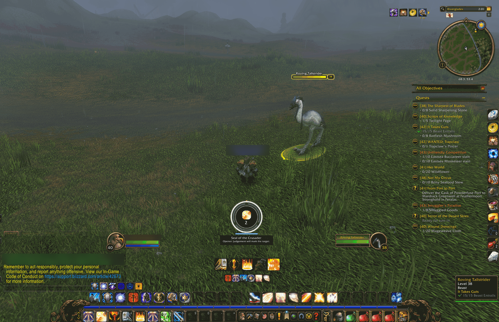
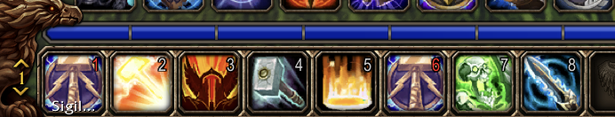

# Sigil

A next-ability helper for Retribution Paladins in World of Warcraft: Forever.

Sigil shows which seal to press and when, your Unsealed Wrath stacks, your swing timer and your mana, all in one halo. It never presses anything for you.

Version 0.2.1, for WoW Forever 1.60.1 (`## Interface: 16001`).

| A seal is called | The opener | Out of combat |
|---|---|---|
|  |  |  |



## What it does

- **One halo.** The spell icon and key to press in the middle, three arcs for Unsealed Wrath stacks, an outer ring for your swing timer, a mana bar underneath.
- **Quiet until it matters.** All attacks sit on one macro key, so the halo shows "Attack" and only pulses and plays a sound when a seal key is needed.
- **Seal weave.** Build three stacks on one seal, swap to the other, release. Command and Righteousness by default; the pair is configurable. Two patterns: 3 and 3 (default, cheaper on mana) or 3 and 1.
- **Crusader opener** (optional). Judge Seal of the Crusader first, on every target or only on elites and bosses.
- **Mana.** A true mana bar, plus a three-level estimate that drops Consecration and the swap when low and calls Seal of Wisdom when nearly empty.
- **Reminders.** No aura, wrong aura, no blessing, drink before the next pull.
- **Side marks.** Consecration on packs, Hammer of Justice just before Judgement, Hammer of Wrath when the target is low enough, Exorcism on undead and demons.
- **Manual stun.** Hammer of Justice stays on its own key; a mark shows when to press it, just before Judgement.

## Install

```sh
tools/install.sh
```

Copies `Sigil/` into `_forever_/Interface/AddOns`. Restart the game the first time; after updates, `/reload` is enough.

It finds the game in `/Applications` on macOS, or in `World of Warcraft`, `Program Files (x86)`, `Program Files` or `Games` on drives C to G on Windows. On Windows, run it from Git Bash or WSL. If your game is somewhere else, pass the AddOns folder:

```sh
tools/install.sh "D:\Games\World of Warcraft\_forever_\Interface\AddOns"
```

## In game

A setup window opens on first login. It creates the Attack macro, lists Sigil's buttons with the key each is on, and can place missing ones into empty bar slots. It never replaces a button.


| Command | Does |
|---|---|
| `/sigil` | Options (also the minimap button) |
| `/sigil setup` | Setup window |
| `/sigil demo` | Plays every halo state outside combat |
| `/sigil compare` | Average kill time per mob for each seal pattern |
| `/sigil check` | Saves a report of what Sigil can read; `/reload` writes it to disk |
| `/sigil lock`, `unlock`, `reset`, `scale 0.6-1.6` | Halo position and size |


Suggested bar, as in the screenshot: 1 the Attack macro, 2 Seal of the Crusader (only if you use the opener), 3 Seal of Command, 4 Seal of Righteousness, 5 Consecration, 6 Hammer of Justice, 7 Hammer of Wrath (once learned), 8 Seal of Wisdom, and Exorcism on any free key. The Attack macro holds only Judgement and Holy Strike: a macro press stops at the first spell it can't cast, so spells that are often unavailable get their own key and a mark. Sigil shows whichever keys you actually use.



## How it works

The game hides buffs, mana, damage and cooldown times from addons during combat. Sigil works from what is left:

- **The stack arcs are drawn by the game.** Sigil tells the game's aura display which buff to show on each arc, and the game fills them from your real Unsealed Wrath stacks, in the seal's colour, even in combat. Sigil never reads the number. If the client doesn't offer that, the arcs show Sigil's own count instead. The technique comes from the Unsealed Wrath Tracker addon.
- **The swap call runs on Sigil's own count.** Every swing adds a stack, unless a miss on your target arrives when your swing's result is due (0.25 to 1.1 seconds after it). That rule applies solo only: in party play the target's misses in that window were all other players', so in a group misses are not counted and your own rare miss can leave the count one high.
- **Only signals the game confirms correct the count:** the Cooldown Manager showing the stack buff gone or present, Seal of Command extra hits that reveal a release, and the real buff after every fight.
- **Who missed** can't be seen: addons get no combat log on this client, and the Combat Log tab passes no fight lines to them (tested live).
- **Mana level** comes from which spells the game says you can afford. The bar shows the true value, drawn by the game; Sigil cannot read it.

Code layout:

- `Sigil/Core/` is pure Lua with no game calls: the decision engine, the tracker and the mana estimate.
- `Sigil/Game.lua` is the only file that reads from the game. Every read is guarded against hidden values.
- `Sigil/UI/` draws the halo, setup, options and minimap button.

## Tested

- Solo, in live fights: the stack count matched the real buff in 50 consecutive fights across both patterns, and the Cooldown Manager's signal agreed with Sigil in over 2,000 checks with no disagreement.
- Seen working live: the Crusader opener, the low-mana level with its drink reminder, the game-drawn stack arcs, Seal of Wisdom at low mana, the Consecration mark on packs, and a Cooldown Manager correction in a party.
- In a party (a few fights), the miss rule undid 3 swings that had in fact landed, so it now applies solo only.
- Not yet seen in a live fight: dungeons and raids.

## Package

```sh
tools/package.sh
```

Writes `dist/Sigil-<version>.zip` with only the `Sigil` folder inside, ready to upload to CurseForge. The version comes from `Sigil/Sigil.toc`. It runs the tests first and stops if any fail.

On Windows, run it from Git Bash or WSL. Without `zip` it uses Windows' own `tar` to write the zip, and if Windows blocks `luajit.exe` it runs the tests with the LuaJIT inside WSL.

## Develop

```sh
luajit tests/run.lua    # engine tests
luajit tests/mock.lua   # whole addon against a fake client; add -v for the report
python3 tools/gen_textures.py   # rebuild artwork (needs rsvg-convert)
```

Turn on "Debug log" in the options to record every fight in detail. The log is saved in `WTF/Account/<account>/<realm>/<character>/SavedVariables/Sigil.lua` on `/reload`.

`docs/design.html` is the original design. The addon has since moved on: real spell icons, a mana bar and two seal patterns.
