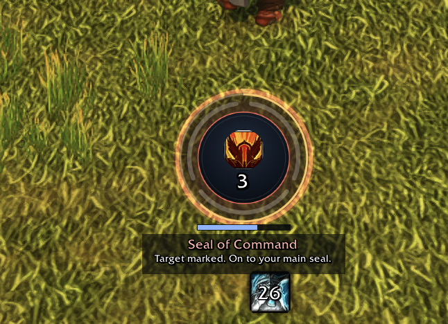
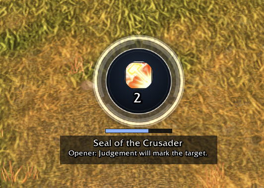
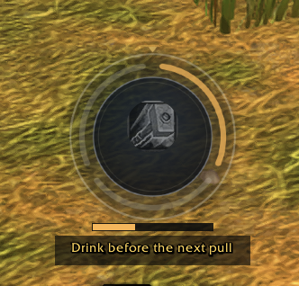
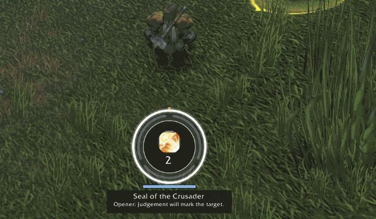
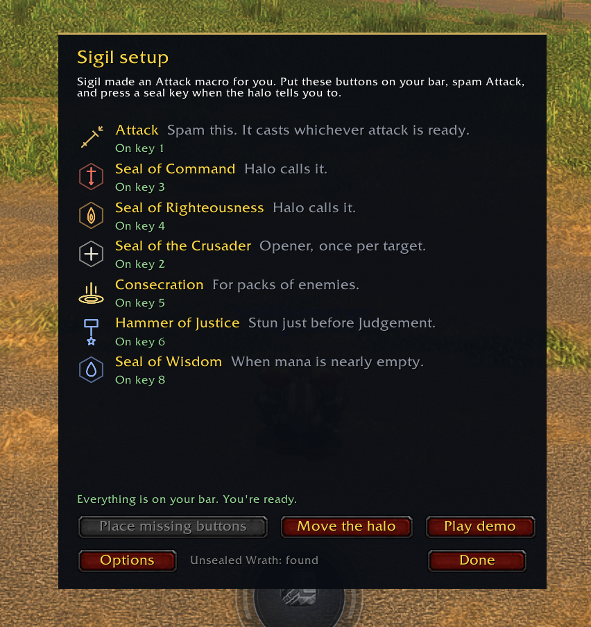
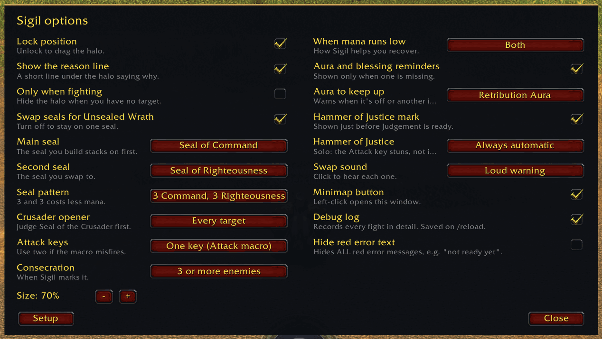

# Sigil

A next-ability helper for Retribution Paladins in World of Warcraft: Forever.

Sigil shows which seal to press and when, your Unsealed Wrath stacks, your swing timer and your mana, all in one halo. It never presses anything for you.

Version 0.2.0, for WoW Forever 1.60.1 (`## Interface: 16001`).

| A seal is called | The opener | Out of combat |
|---|---|---|
|  |  |  |



## What it does

- **One halo.** The spell icon and key to press in the middle, three arcs for Unsealed Wrath stacks, an outer ring for your swing timer, a mana bar underneath.
- **Quiet until it matters.** All attacks sit on one macro key, so the halo shows "Attack" and only pulses and plays a sound when a seal key is needed.
- **Seal weave.** Build three stacks on one seal, swap to the other, release. Command and Righteousness by default; the pair is configurable. Two patterns: 3 and 3 (default, cheaper on mana) or 3 and 1.
- **Crusader opener** (optional). Judge Seal of the Crusader first, on every target or only on elites and bosses.
- **Mana.** A true mana bar, plus a three-level estimate that drops Consecration and the swap when low and calls Seal of Wisdom when nearly empty.
- **Reminders.** No aura, wrong aura, no blessing, drink before the next pull.
- **Side marks.** Consecration on packs, Hammer of Justice just before Judgement.
- **Stun your way.** Hammer of Justice is manual by default. It can also fire from the Attack key only while solo, staying manual in groups, or always.

## Install

```sh
tools/install.sh
```

Copies `Sigil/` into `_forever_/Interface/AddOns`. Restart the game the first time; after updates, `/reload` is enough.

## In game

A setup window opens on first login. It creates the Attack macro, lists Sigil's buttons with the key each is on, and can place missing ones into empty bar slots. It never replaces a button.



| Command | Does |
|---|---|
| `/sigil` | Options (also the minimap button) |
| `/sigil setup` | Setup window |
| `/sigil demo` | Plays every halo state outside combat |
| `/sigil compare` | Average kill time per mob for each seal pattern |
| `/sigil check` | Saves a report of what Sigil can read; `/reload` writes it to disk |
| `/sigil lock`, `unlock`, `reset`, `scale 0.6-1.6` | Halo position and size |



Suggested bar: 1 Attack macro, 2 Seal of Command, 3 Seal of Righteousness, 4 Consecration, 5 Hammer of Justice, and Seal of Wisdom on any key. Sigil shows whichever keys you actually use.

## How it works

The game hides buffs, mana, damage and cooldown times from addons during combat. Sigil works from what is left:

- **Seal and stacks** are counted from your own casts and swings. A missed swing stores no stack; Sigil tells swing misses from ability misses by timing.
- **After every fight** the count is compared with the real buffs and corrected.
- **Mid-fight**, the game's Cooldown Manager (if enabled, with Unsealed Wrath and Seals tracked) tells Sigil when a buff is gone.
- **Mana level** comes from which spells the game says you can afford. The bar shows the true value, drawn by the game; Sigil cannot read it.

Code layout:

- `Sigil/Core/` is pure Lua with no game calls: the decision engine, the tracker and the mana estimate.
- `Sigil/Game.lua` is the only file that reads from the game. Every read is guarded against hidden values.
- `Sigil/UI/` draws the halo, setup, options and minimap button.

## Tested

- Solo, in live fights: the stack count matched the real buff in 50 consecutive fights across both patterns, and the Cooldown Manager's signal agreed with Sigil in over 2,000 checks with no disagreement.
- Seen working live: the Crusader opener, the low-mana level with its drink reminder, and the automatic stun.
- Not yet seen in a live fight: Seal of Wisdom recovery, the Consecration mark, groups and dungeons, and the Cooldown Manager correction itself.

## Develop

```sh
luajit tests/run.lua    # engine tests
luajit tests/mock.lua   # whole addon against a fake client; add -v for the report
python3 tools/gen_textures.py   # rebuild artwork (needs rsvg-convert)
```

Turn on "Debug log" in the options to record every fight in detail. The log is saved in `WTF/Account/<account>/<realm>/<character>/SavedVariables/Sigil.lua` on `/reload`.

`docs/design.html` is the original design. The addon has since moved on: real spell icons, a mana bar and two seal patterns.
